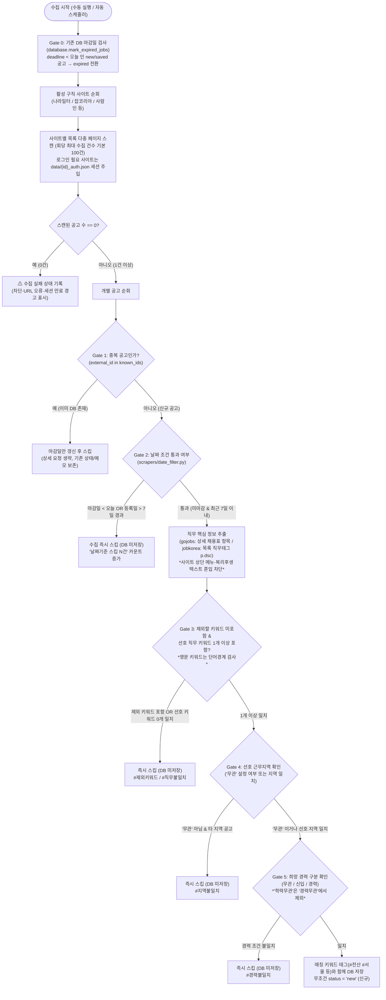
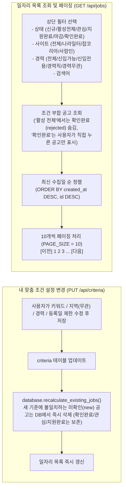

# 맞춤 일자리 에이전트 핵심 아키텍처 & 플로우차트 (`FLOWCHART.md`)

> **[필수 규칙]** 이 문서와 **[`데이터-필터-조건/`](file:///Users/danyoh/XXX-AGENT/kr-job-agent/데이터-필터-조건/README.md)** 하위 사이트별 문서는 `kr-job-agent`의 수집·필터링·대시보드 동작의 **단일 진실 공급원(Single Source of Truth)**입니다.  
> **모든 소스 코드(`scrapers/`, `matcher.py`, `database.py`, `app.py`, `templates/index.html`)를 수정하기 전 반드시 [`데이터-필터-조건/*.md`](file:///Users/danyoh/XXX-AGENT/kr-job-agent/데이터-필터-조건/README.md)와 이 플로우차트를 먼저 참조해야 하며, 로직 변경 시 두 문서도 함께 업데이트해야 합니다.**

---

## 1. 내가 원하는 일자리 조건 설정 구조 (`criteria` 테이블)

*(AI/LLM 연동 없이 100% 빠르고 정확한 규칙 기반으로만 동작합니다.)*

| 설정 항목 | 컬럼명 | 현재 기준 예시 | 동작 규칙 |
| :--- | :--- | :--- | :--- |
| **선호 직무 / 핵심 키워드** | `include_keywords` | `전산, 데이터, IT, 개발, AI` | **최소 1개 이상 필수 포함** (미포함 시 DB에 저장하지 않고 즉시 스킵). 1) `IT`, `AI` 등 영문 키워드는 영문 단어 경계(`(?<![a-zA-Z])kw(?![a-zA-Z])`)로 검사하여 `gmail`, `site`, `with` 등 오탐 방지 2) `서류접수 : ...`, `원서접수 : ...`, `접수방법 : ...` 등 일정·접수 안내 구문과 행정·문서 상용구(`전자공문`, `전자 공문`, `전자우편`, `전자 우편`, `전자메일`, `전자 메일`, `전자접수`, `전자수입인지`, `전자정부법`, `전자문서` 등)는 사전 제거하여 `전자` 키워드와 혼동되지 않도록 미참조 처리 3) 잡코리아는 상단 메뉴(`AI·개발·데이터`)나 본문 전체가 섞이지 않도록 목록의 순수 직무 요약(`title` + `p.dsc` 직무태그)만 검사 |
| **제외할 키워드** | `exclude_keywords` | `영업지원, 제약, 전산입력` (선택) | **1개라도 포함 시 DB에 저장하지 않고 즉시 스킵** (선호 키워드 검사보다 먼저 수행) |
| **선호 근무지역** | `preferred_locations` | `서울, 경기, 인천, 세종` 또는 `무관` | **`무관` 포함 시 모든 공고를 선호지역으로 인정**. 특정 지역 지정 시 해당 지역 외 공고는 DB에 저장하지 않고 즉시 스킵 |
| **희망 경력 구분** | `preferred_career` | `무관` / `신입` / `경력` | **`무관`이면 신입·경력 모든 공고 허용**. `신입` 선택 시 순수 경력직 전용 공고는 DB에 저장하지 않고 즉시 스킵 (`학력무관`, `성별무관`, `연령무관`, `전공무관` 및 공무원 `경력경쟁채용시험`은 제거하여 오판 방지) |
| **최근 등록일 제한** | `max_age_days` | `7` (일) | 등록일(`posted_at`)이 오늘 기준 **7일 초과 시 수집 단계에서 즉시 스킵 (DB 미저장)** |
| **자동 업데이트 주기** | `schedule_minutes` | `180` (분) | 백그라운드 스케줄러 자동 수집 주기 |

---

## 2. 공고 수집 · 5단계 게이트 필터링 플로우차트

---

## 3. 조건 변경 및 일자리 목록(10개 페이징) 표시 플로우차트

---

## 4. 소스 파일별 책임 및 수정 시 체크리스트

| 파일 경로 | 핵심 역할 | 수정 시 반드시 확인할 사항 |
| :--- | :--- | :--- |
| [`database.py`](file:///Users/danyoh/XXX-AGENT/kr-job-agent/database.py) | SQLite 스키마, 중복 체크, 마감 전환, DB 초기화(`reset_jobs_db`), 사이트 삭제(`delete_source`), 기존 공고 재계산, 목록 정렬 | `ORDER BY created_at DESC, id DESC` 유지, 기본 `max_items = 100` 유지, `'학력무관'` 제거 유지, 삭제된 기본 사이트 재생성 방지 유지 |
| [`matcher.py`](file:///Users/danyoh/XXX-AGENT/kr-job-agent/matcher.py) | Gate 3~5 순수 규칙 기반 필터링 (AI 의존성 없음) | 1) 영문 키워드 단어 경계 매칭 유지 2) 선호 직무 키워드 0개 일치 시 `hard_excluded = True` 유지 3) 선호 지역 `'무관'` 및 희망 경력 `'무관'` 처리 유지 |
| [`scrapers/date_filter.py`](file:///Users/danyoh/XXX-AGENT/kr-job-agent/scrapers/date_filter.py) | Gate 2 마감일 및 등록일(7일) 검사 | `deadline < today` 및 `(today - posted_at).days > max_age_days` 즉시 스킵 유지 |
| [`scrapers/__init__.py`](file:///Users/danyoh/XXX-AGENT/kr-job-agent/scrapers/__init__.py) | 전체 수집 파이프라인 오케스트레이션 | `scanned_here == 0` 일 때 `수집 실패` 상태 기록 유지 |
| [`templates/index.html`](file:///Users/danyoh/XXX-AGENT/kr-job-agent/templates/index.html) | 로컬 웹 대시보드 UI (10개 페이징, 필터, 설정, DB 초기화 후 다시 받기) | AI 관련 요소 없이 깔끔한 키워드/지역/경력 필터, 기본 `max_items = 100`, 10개 페이징(`PAGE_SIZE = 10`) 유지 |
